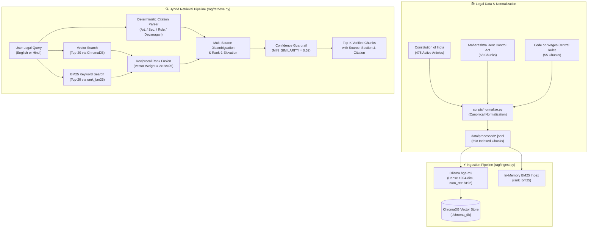

# Legal Lens ⚖️🔍

> **Multilingual AI Legal Assistant & Hybrid RAG Retrieval Engine for Indian Law**  
> Covering the Constitution of India, Central & State Statutes, Subordinate Rules, and Supreme Court Decisions.

[](https://www.python.org/)
[](https://www.trychroma.com/)
[](https://ollama.ai/)
[](https://github.com/dorianbrown/rank_bm25)
[](#)
[](LICENSE)

---

## 📌 Overview

**Legal Lens** is a production-grade, citation-grounded legal retrieval and reasoning platform designed to make Indian law accessible, searchable, and verifiable for citizens, legal professionals, and researchers.

By combining **dense multilingual embeddings**, **sparse keyword retrieval (BM25)**, **Reciprocal Rank Fusion (RRF)**, and **deterministic legal citation boosting**, Legal Lens delivers accurate legal answers with verified statutory citations down to the exact Article, Section, or Rule number — completely eliminating legal hallucinations.

### 🌟 Key Highlights
- **Comprehensive Indian Legal Corpus**:
  - **The Constitution of India** (all 25 Parts, 503 Articles, 12 Schedules, 3 Appendices; 475 active searchable chunks).
  - **State Tenancy Legislation**: *The Maharashtra Rent Control Act, 1999 (MRCA)* (68 active searchable chunks).
  - **Central Subordinate Legislation**: *The Code on Wages (Central) Rules, 2026* (55 active substantive rule chunks).
  - **Supreme Court Case Law**: 1,104 verified Q&A pairs with *ratio decidendi* across 11 key legal domains.
  - **Statutory Catalog**: 891 Central Acts metadata catalog (Act No., Year, Enactment Date, Amendment Status).
- **True Multilingual Support**: Seamless retrieval across **English** and **Hindi (Devanagari)** legal and layperson phrasing.
- **Deterministic Citation Boosting & Disambiguation**: Deterministically routes queries like `"Article 21"` or `"अनुच्छेद २१"` to the Constitution, while safely disambiguating shared section numbers (`"Section 16"`, `"Rule 21"`) across multiple statutes.
- **Hallucination Guardrails**: Calibrated similarity confidence cutoff (`MIN_SIMILARITY = 0.52`) providing a strict `+0.0720` separation gap against out-of-scope or non-legal queries.
- **Benchmark Evaluation**: **92.3% Hit@1, 96.2% Hit@3, 100.0% Hit@5** across 26 test queries (100% Hit@1 on English queries).

---

## 🏗 System Architecture



---

## 📊 Benchmark & Evaluation Results

Evaluated using the automated benchmark suite in [`eval/run_eval.py`](file:///eval/run_eval.py) against 28 real-world legal queries across fundamental rights, tenancy eviction, wage deductions, and out-of-scope scenarios:

| Metric | Overall (26 In-Scope) | English (14 Queries) | Hindi (12 Queries) |
| :--- | :---: | :---: | :---: |
| **Hit@1** | **92.3%** (24/26) | **100.0%** (14/14) | **83.3%** (10/12) |
| **Hit@3** | **96.2%** (25/26) | **100.0%** (14/14) | **91.7%** (11/12) |
| **Hit@5** | **100.0%** (26/26) | **100.0%** (14/14) | **100.0%** (12/12) |

### Out-of-Scope Separation & Confidence Threshold
- **In-Scope Hits Cosine Similarity**: Min `0.5259`, Mean `0.6345`, Max `0.7605`.
- **Out-of-Scope Queries (e.g. Consumer complaints, e-FIRs)**: Min `0.4523`, Mean `0.4531`, Max `0.4539`.
- **Separation Margin**: `+0.0720` clean buffer between authentic legal questions and out-of-domain input.

---

## 🚀 Quickstart Guide

### 1. Prerequisites
- Python 3.10+
- [Ollama](https://ollama.ai/) installed and running locally with the `bge-m3` embedding model:
  ```bash
  ollama pull bge-m3
  ollama serve
  ```

### 2. Installation
```bash
git clone https://github.com/NotNirav/Legal-Lens.git
cd Legal-Lens
pip install -r requirements.txt
```

### 3. Normalize & Ingest Legal Corpus
```bash
# Normalize raw source texts into canonical schema (if modifying sources)
python scripts/normalize.py

# Ingest all active statutory and constitutional records into ChromaDB
python rag/ingest.py
```

### 4. Run Retrieval Queries via CLI
```bash
# English layperson tenancy query
python rag/retrieve.py "can my landlord throw me out without notice"

# Hindi layperson constitutional query
python rag/retrieve.py "क्या पुलिस बिना वारंट गिरफ्तार कर सकती है"

# Direct citation query with Devanagari numerals
python rag/retrieve.py "अनुच्छेद २१"

# Specific statute section query
python rag/retrieve.py "Maharashtra Rent Control Act section 16"
```

### 5. Run the Automated Evaluation Suite
```bash
python eval/run_eval.py
```

### 6. Search Extracted Supreme Court Decisions
```bash
python legal_rights_extraction/search_qa.py "preventive detention grounds"
```

---

## 📁 Repository Structure

```text
Legal-Lens/
├── README.md                                       # Master repository documentation (this file)
├── files.md                                        # Detailed index of all files, datasets & modules
├── requirements.txt                                # Python runtime dependencies
├── LICENSE                                         # MIT Open Source License
│
├── data/                                           # Constitutional & Statutory Source Data
│   ├── COI.json                                    # Hierarchical JSON tree of Constitution of India
│   ├── constitution_chunks.jsonl                   # Raw 519 Constitution chunk records
│   ├── constitution_of_india.md                    # Master single-file Constitution markdown
│   ├── README.md                                   # Comprehensive data directory documentation
│   ├── markdown/                                   # 41 section-level markdown documents (Parts & Schedules)
│   └── processed/                                  # Production RAG-ready datasets
│       ├── constitution.jsonl                      # 519 normalized constitutional records (475 indexed)
│       └── acts.jsonl                              # 218 normalized statutory records (123 indexed)
│
├── rag/                                            # Core Hybrid RAG Pipeline
│   ├── __init__.py                                 # Package entry point
│   ├── ingest.py                                   # ChromaDB batch embedding & upsert pipeline
│   └── retrieve.py                                 # Hybrid search (Dense Vector + BM25 + RRF + Citation Boost)
│
├── eval/                                           # Evaluation & Benchmarking
│   ├── questions.jsonl                             # 28 benchmark evaluation questions (EN & HI)
│   └── run_eval.py                                 # Metric evaluator (Hit@1/3/5 & similarity distributions)
│
├── scripts/                                        # Utilities & Data Normalizers
│   ├── normalize.py                                # Canonical schema adapter & statutory cleaner
│   └── test_retrieval.py                           # Benchmark test runner
│
├── rag_legal_markdown/                             # Statutory Markdown Corpora
│   ├── 01_central_acts.md                          # Parliamentary Acts (IRC 2020, RERA 2016)
│   ├── 02_rules_regulations.md                     # Subordinate Legislation (Code on Wages Rules 2026)
│   ├── 03_state_laws.md                            # State Laws (Maharashtra Rent Control Act 1999)
│   └── 04_amendments_metadata.md                   # 891 Central Acts reference directory
│
├── legal_rights_extraction/                        # Supreme Court NLP Extraction Engine
│   ├── extract_legal_qa.py                         # Ratio decidendi & legal rights parser
│   ├── search_qa.py                                # CLI search utility over court Q&As
│   └── demo.py                                     # Interactive demo workflow
│
└── output/                                         # Extracted Case Law Datasets
    ├── legal_qa_dataset.json                       # 1,104 verified Supreme Court Q&A pairs (JSON array)
    ├── legal_qa_dataset.jsonl                      # 1,104 verified Supreme Court Q&A pairs (JSONL)
    ├── dataset_summary.json                        # Metadata aggregate summary & domain statistics
    └── README.md                                   # Court decisions dataset documentation
```

*For an in-depth breakdown of every individual file and schema, see [`files.md`](file:///files.md).*

---

## 📋 Data Schema

All records in `data/processed/*.jsonl` adhere to the canonical Legal Lens schema:

| Field | Type | Description |
| :--- | :--- | :--- |
| `id` | `string` | Unique chunk identifier (`coi-art-21`, `mrca1999-s16-p1`, `cow-rules-2026-r21`). |
| `source` | `string` | Full official statute or constitutional name. |
| `section` | `string` | Normalized section, article, or rule citation (`Article 21`, `Section 16`, `Rule 21`). |
| `title` | `string` | Descriptive title including number. |
| `text` | `string` | Cleaned, verbatim legal text. |
| `lang` | `string` | Language code (`en`). |
| `tags` | `list[str]` | Thematic / domain tags. |
| `status` | `string` | Statutory status (`in_force`, `repealed`, `not_in_force`). |
| `jurisdiction` | `string` | Jurisdiction (`India`, `Maharashtra`). |
| `parent_act` | `string?` | Enabling parent Act for subordinate rules (e.g., `Code on Wages, 2019`). |
| `index` | `boolean` | `true` for searchable substantive law; `false` for repealed articles, forms, or schedules. |

---

## 👥 Contributors & Acknowledgements

Developed for **Hacktober 2026 / NST - ADYPU**.  
- Built with authoritative statutory text from the **Ministry of Law and Justice (Legislative Department)**, Government of India.  
- Case law ratio decidendi extracted from Supreme Court of India decisions.

---

## 📄 License

This project is licensed under the [MIT License](LICENSE).
