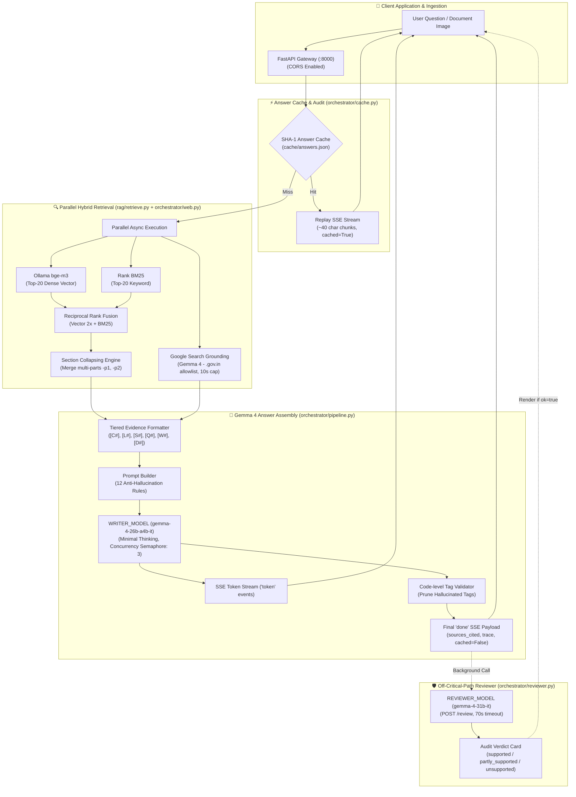

# Legal Lens ⚖️🔍

> **Multilingual AI Legal Assistant & Hybrid RAG Retrieval Engine for Indian Law**  
> Powered by Google Gemma 4, Hybrid Dense Vector + Sparse BM25 RAG, Multimodal Document Vision, and Verified Supreme Court Precedents.

[](https://www.python.org/)
[](https://fastapi.tiangolo.com/)
[](https://www.trychroma.com/)
[](https://ollama.ai/)
[](https://github.com/dorianbrown/rank_bm25)
[](https://deepmind.google/technologies/gemma/)
[](LICENSE)

---

## 📌 Overview

**Legal Lens** is a production-grade, citation-grounded legal assistant and API platform designed to make Indian law accessible, searchable, and verifiable for citizens, legal aid volunteers, and researchers.

By combining **dense multilingual embeddings (`bge-m3`)**, **sparse keyword retrieval (`rank_bm25`)**, **reciprocal rank fusion (2x RRF)**, **deterministic citation boosting**, **section collapsing**, **official web grounding**, and **Google Gemma 4 reasoning**, Legal Lens provides plain-language answers backed by verified statutory citations down to the exact Article, Section, or Rule number — completely eliminating legal hallucinations.

### 🌟 Key Highlights
- **Comprehensive Indian Legal Corpus**:
  - **The Constitution of India**: All 25 Parts, 503 Articles, 12 Schedules (475 active searchable chunks).
  - **State Tenancy Legislation**: *The Maharashtra Rent Control Act, 1999 (MRCA)* (69 active chunks).
  - **Central Subordinate Legislation**: *The Code on Wages (Central) Rules, 2026* (54 active chunks).
  - **Supreme Court Case Law**: 1,104 verified Q&A pairs with *ratio decidendi* across 11 key legal domains.
  - **28-State Legal Guide**: In-depth state-by-state catalog in [`state rules.md`](file:///state%20rules.md).
  - **Statutory Catalog**: Master directory of 891 Central Parliamentary Acts.
- **Multimodal Document Analysis (`/ask/document`)**: Upload eviction notices, salary slips, or tenancy agreements (JPG, PNG, WEBP). Gemma 4 Vision extracts metadata into `[D1]`.. evidence items, runs tiered statutory retrieval, and streams compliance analysis.
- **Off-Critical-Path Claim Reviewer (`/review`)**: High-parameter `REVIEWER_MODEL` (`gemma-4-31b-it`) audits generated answers against evidence, outputting a structured verdict (`supported`, `partly_supported`, `unsupported`) without delaying initial answer streaming.
- **Multi-Tiered Evidence Aggregation**: Tagged citations across Constitution (`[C#]`), Central Law (`[L#]`), State Law (`[S#]`), Case Law Q&A (`[Q#]`), Official Web Grounding (`[W#]`), and Uploaded Documents (`[D#]`).
- **Grounded Official Web Search**: Uses Gemma 4 with Google Search grounding, strictly filtering URLs to `.gov.in` and `.nic.in` domains with a 10s hard timeout.
- **Deterministic Hallucination Guardrails & RAG Fallback**: If models time out or encounter rate limits, the system produces a verified, direct statutory excerpt answer in code (`fallback=True`).
- **Instant SHA-1 Caching & Offline Mode**: Pre-generated answers are cached in `cache/answers.json`. The `CACHE_ONLY=1` environment flag guarantees 0 model calls for offline demonstrations.
- **Streaming REST API**: Server-Sent Events (SSE) streaming on `/ask` and `/ask/document` for smooth token delivery to web and mobile frontends.

---

## 🏗 System Architecture



---

## 🚀 How to Run the Demo

Follow these exact steps in order to launch Legal Lens and connect it to a web or mobile frontend:

### Step 1: Start Ollama and Pull the Embedding Model
In your first terminal, verify that Ollama is active and that the multilingual `bge-m3` embedding model is pulled:
```bash
# Start Ollama service (if not already running as a system service)
ollama serve

# Verify or pull the required 1024-dim embedding model
ollama pull bge-m3
```

### Step 2: Start the Legal Lens Backend API
In your second terminal, launch the FastAPI server using the automated demo startup script:
```powershell
# Windows PowerShell:
powershell -ExecutionPolicy Bypass -File scripts/start_demo.ps1

# Linux / macOS:
uvicorn api.main:app --host 0.0.0.0 --port 8000
```
*The script validates that Ollama is healthy on `localhost:11434`, checks that `bge-m3` is installed, and launches Uvicorn on port 8000.*

### Step 3: Start the Cloudflare Tunnel (for External / Mobile Access)
In your third terminal, expose the local server via a public Cloudflare tunnel:
```bash
cloudflared tunnel --url http://localhost:8000
```
*Copy the generated `https://<random-subdomain>.trycloudflare.com` URL from the terminal output.*

### Step 4: Configure the Frontend API URL
In your frontend application's root directory, update `.env` or `.env.local`:
```ini
# If running locally on the same device:
NEXT_PUBLIC_API_URL=http://localhost:8000

# If accessing from mobile, tablet, or external demo:
NEXT_PUBLIC_API_URL=https://<your-subdomain>.trycloudflare.com
```
Then start your frontend development server:
```bash
npm run dev
```

---

## 🛠 If Something Breaks (Troubleshooting Matrix)

| Scenario | Symptoms & Errors | Root Cause | Exact Resolution Action |
| :--- | :--- | :--- | :--- |
| **Ollama Down** | HTTP `503 Service Unavailable`: *"Ollama service is unreachable. Please verify Ollama is active..."* | Ollama service is stopped or port `11434` is blocked. | Run `ollama serve` in a terminal. Test connectivity with `curl http://localhost:11434/api/tags`. If `bge-m3` is missing, run `ollama pull bge-m3`. |
| **Gemma Model Timeout** | Generation takes > 45s, or upstream returns `504 Gateway Timeout` / `429 Resource Exhausted`. | Google GenAI free tier latency spike or rate limit. | **Automatic**: The backend automatically engages `build_rag_fallback_answer()` in code, returning verified statutory excerpts without crashing. To bypass models entirely during offline demos, set `CACHE_ONLY=1` in your `.env`. |
| **Web Search Grounding Fails** | SSE stream shows `web_evidence` latency `10.0s` with `ok: false` in trace. | Upstream search grounding timeout (> 10s) or no official `.gov.in`/`.nic.in` sources found. | **No action required**. The pipeline is designed with a fail-safe boundary: on web failure, it cleanly proceeds using indexed statutory and constitutional records. |
| **Tunnel URL Changed** | Frontend shows `TypeError: Failed to fetch` or CORS network error; search requests fail immediately. | Cloudflare tunnel process was restarted, invalidating the previous random subdomain URL. | Check the running `cloudflared` terminal for the new `https://*.trycloudflare.com` URL. Update `NEXT_PUBLIC_API_URL` in the frontend `.env`, and reload the browser page. |

---

## 🌐 API Endpoints Summary

For comprehensive JSON schemas, sample payloads, and SSE stream reading implementations, see the complete [Frontend API Documentation (`docs/API.md`)](file:///docs/API.md).

| Endpoint | Method | Content-Type | Description |
| :--- | :---: | :---: | :--- |
| **`/health`** | `GET` | `application/json` | Health status, indexed chunk count, configured models (`writer`, `vision`, `reviewer`), and cache size. |
| **`/states`** | `GET` | `application/json` | List of all 28 Indian States with `covered: true` (indexed) or `covered: false` (`Central law only`). |
| **`/sources`** | `GET` | `application/json` | Overview of loaded statutes, consolidation dates, and legal validity statuses. |
| **`/retrieve`** | `POST` | `application/json` | Hybrid dense vector + BM25 keyword legal search with citation boosting and confidence filtering. |
| **`/retrieve/tiered`** | `POST` | `application/json` | Tiered statutory retrieval separated into Constitution, Central, State, and QA results. |
| **`/ask`** | `POST` | `text/event-stream` | Streaming SSE legal guidance. Emits `sources`, `trace`, `token`, `done`, and `error` events. |
| **`/ask/sync`** | `POST` | `application/json` | Synchronous legal question answering returning complete assembled answer and citations in JSON. |
| **`/ask/document`** | `POST` | `multipart/form-data` | Multimodal document vision analysis (JPG, PNG, WEBP <= 8MB) streaming explanation via SSE. |
| **`/review`** | `POST` | `application/json` | Post-answer audit using `REVIEWER_MODEL` (`gemma-4-31b-it`). Returns `{ok: true, verdict: ...}` or `{ok: false}`. |

---

## 📊 Benchmark & Evaluation Results

Evaluated using the automated benchmark suite in [`eval/run_eval.py`](file:///eval/run_eval.py) against 28 real-world legal queries across fundamental rights, tenancy eviction, wage deductions, and out-of-scope scenarios:

| Metric | Overall (26 In-Scope) | English (14 Queries) | Hindi (12 Queries) |
| :--- | :---: | :---: | :---: |
| **Hit@1** | **92.3%** (24/26) | **100.0%** (14/14) | **83.3%** (10/12) |
| **Hit@3** | **96.2%** (25/26) | **100.0%** (14/14) | **91.7%** (11/12) |
| **Hit@5** | **100.0%** (26/26) | **100.0%** (14/14) | **100.0%** (12/12) |

---

## ⚙️ Environment Variables Reference

Copy `.env.example` to `.env` to configure your environment:
```ini
# Google Gemini / Gemma API Credentials
GEMINI_API_KEY=your_gemini_api_key_here

# Model Identifiers
WRITER_MODEL=gemma-4-26b-a4b-it
VISION_MODEL=gemma-4-26b-a4b-it
REVIEWER_MODEL=gemma-4-31b-it

# Execution Timeouts (seconds)
WRITER_TIMEOUT=45
VISION_TIMEOUT=45
REVIEWER_TIMEOUT=70

# Offline Demo Cache Mode (1 = bypass all model calls, 0 = normal execution)
CACHE_ONLY=0

# Frontend Base URL
NEXT_PUBLIC_API_URL=http://localhost:8000
```

---

## 📄 License

This project is licensed under the [MIT License](LICENSE). Developed for **Hacktober 2026 / NST - ADYPU**.
