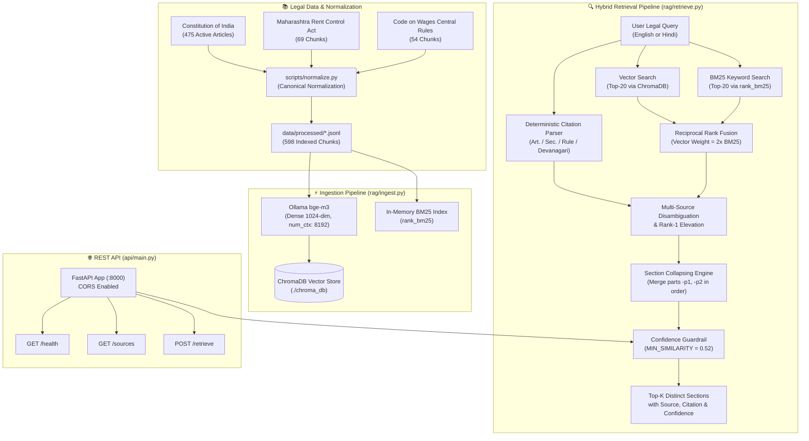

# Legal Lens ⚖️🔍

> **Multilingual AI Legal Assistant & Hybrid RAG Retrieval Engine for Indian Law**  
> Covering the Constitution of India, Central & State Statutes, Subordinate Rules, and Supreme Court Decisions.

[](https://www.python.org/)
[](https://fastapi.tiangolo.com/)
[](https://www.trychroma.com/)
[](https://ollama.ai/)
[](https://github.com/dorianbrown/rank_bm25)
[](#)
[](LICENSE)

---

## 📌 Overview

**Legal Lens** is a production-grade, citation-grounded legal retrieval, analysis, and API platform designed to make Indian law accessible, searchable, and verifiable for citizens, legal professionals, and researchers.

By combining **dense multilingual embeddings**, **sparse keyword retrieval (BM25)**, **Reciprocal Rank Fusion (RRF)**, **deterministic citation boosting**, and **section collapsing**, Legal Lens delivers accurate legal answers with verified statutory citations down to the exact Article, Section, or Rule number — completely eliminating legal hallucinations.

### 🌟 Key Highlights
- **Comprehensive Indian Legal Corpus**:
  - **The Constitution of India** (all 25 Parts, 503 Articles, 12 Schedules, 3 Appendices; 475 active searchable chunks).
  - **State Tenancy Legislation**: *The Maharashtra Rent Control Act, 1999 (MRCA)* (69 active searchable chunks).
  - **Central Subordinate Legislation**: *The Code on Wages (Central) Rules, 2026* (54 active substantive rule chunks).
  - **Supreme Court Case Law**: 1,104 verified Q&A pairs with *ratio decidendi* across 11 key legal domains.
  - **Statutory Catalog**: 891 Central Acts metadata catalog (Act No., Year, Enactment Date, Amendment Status).
- **True Multilingual Support**: Seamless retrieval across **English** and **Hindi (Devanagari)** legal and layperson phrasing.
- **Section Collapsing & Deduplication**: Long procedural sections split into subparts (`-p1`, `-p2`, `-p3`) are automatically collapsed into a single consolidated result at the best-ranked part's position, ensuring top-k results always represent distinct sections.
- **Deterministic Citation Boosting & Disambiguation**: Deterministically routes queries like `"Article 21"` or `"अनुच्छेद २१"` to the Constitution, while safely disambiguating shared section numbers (`"Section 16"`, `"Rule 21"`) across multiple statutes.
- **Hallucination Guardrails**: Calibrated similarity confidence cutoff (`MIN_SIMILARITY = 0.52`) providing a strict `+0.0720` separation gap against out-of-scope or non-legal queries.
- **Benchmark Evaluation**: **92.3% Hit@1, 96.2% Hit@3, 100.0% Hit@5** across 26 test queries (100% Hit@1 on English queries).
- **Production REST API**: Built with FastAPI, equipped with CORS, `/health`, `/sources`, `/retrieve`, and automated Ollama fail-safes.

---

## 🏗 System Architecture



---

## 📊 Benchmark & Evaluation Results

Evaluated using the automated benchmark suite in [`eval/run_eval.py`](file:///eval/run_eval.py) against 28 real-world legal queries across fundamental rights, tenancy eviction, wage deductions, and out-of-scope scenarios:

| Metric | Overall (26 In-Scope) | English (14 Queries) | Hindi (12 Queries) |
| :--- | :---: | :---: | :---: |
| **Hit@1** | **92.3%** (24/26) | **100.0%** (14/14) | **83.3%** (10/12) |
| **Hit@3** | **96.2%** (25/26) | **100.0%** (14/14) | **91.7%** (11/12) |
| **Hit@5** | **100.0%** (26/26) | **100.0%** (14/14) | **100.0%** (12/12) |

### Out-of-Scope Separation & Confidence Threshold
- **In-Scope Hits Cosine Similarity**: Min `0.5259`, Mean `0.6345`, Max `0.7605`.
- **Out-of-Scope Queries (e.g. Consumer complaints, e-FIRs)**: Min `0.4523`, Mean `0.4531`, Max `0.4539`.
- **Separation Margin**: `+0.0720` clean buffer between authentic legal questions and out-of-domain input.

---

## 🚀 Setup & Execution Guide

### 1. Prerequisites
- **Python**: Python 3.10 or higher
- **Ollama**: Download and install from [ollama.ai](https://ollama.ai/)
- Pull the multilingual legal embedding model:
  ```bash
  ollama pull bge-m3
  ollama serve
  ```

### 2. Environment Setup
```bash
# Clone the repository
git clone https://github.com/NotNirav/Legal-Lens.git
cd Legal-Lens

# Create and activate virtual environment
python -m venv venv
# On Windows PowerShell:
.\venv\Scripts\Activate.ps1
# On Linux/macOS:
source venv/bin/activate

# Install all dependencies
pip install -r requirements.txt
```

---

## ⚡ Canonical Execution Order

To build the knowledge base, index the corpus, evaluate performance, and launch the REST API server, run the commands in this exact sequence:

```bash
# Step 1: Normalize raw statutory & constitutional documents into canonical schema
python scripts/normalize.py

# Step 2: Ingest active chunks into ChromaDB with Ollama bge-m3 embeddings
python rag/ingest.py

# Step 3: Run the 28-query evaluation benchmark suite
python eval/run_eval.py

# Step 4: Launch the production FastAPI server
uvicorn api.main:app --host 0.0.0.0 --port 8000
```

Once running, interactive API documentation is accessible at:
- **Swagger UI**: `http://localhost:8000/docs`
- **ReDoc**: `http://localhost:8000/redoc`

---

## 🌐 REST API Endpoints

The API is fully asynchronous, supports CORS from all origins, and provides JSON error responses if Ollama is unreachable.

### 1. `GET /health`
Returns system status and total count of active legal chunks loaded in memory.
```bash
curl -s http://127.0.0.1:8000/health
```
```json
{
  "status": "ok",
  "chunks": 598
}
```

### 2. `GET /sources`
Returns an overview of all indexed statutes, active chunk counts, consolidation dates, and statuses.
```bash
curl -s http://127.0.0.1:8000/sources
```
```json
[
  {
    "source": "Constitution of India",
    "chunks": 475,
    "text_as_on": "1st May, 2024",
    "status": "Active"
  },
  {
    "source": "The Code on Wages (Central) Rules, 2026",
    "chunks": 54,
    "text_as_on": "8th May, 2026",
    "status": "In Force"
  },
  {
    "source": "The Maharashtra Rent Control Act, 1999",
    "chunks": 69,
    "text_as_on": "31st March, 2000 (Text as on 7th March, 2025)",
    "status": "In Force"
  }
]
```

### 3. `POST /retrieve`
Executes hybrid search across the legal corpus.

**Request Payload**:
```json
{
  "query": "can my landlord throw me out without notice",
  "k": 5,
  "sources": null
}
```

**Curl Command**:
```bash
curl -s -X POST http://127.0.0.1:8000/retrieve \
  -H "Content-Type: application/json" \
  -d '{"query": "can my landlord throw me out without notice", "k": 5}'
```

**Response Example**:
```json
{
  "results": [
    {
      "id": "mrca1999-s20",
      "source": "The Maharashtra Rent Control Act, 1999",
      "section": "Section 20",
      "title": "Section 20: Tenants’ right to give notice to landlord of his intention to occupy tenement in new building",
      "part_title": null,
      "parent_act": "",
      "status": "In Force",
      "text_as_on": "31st March, 2000 (Text as on 7th March, 2025)",
      "text": "**20. Tenants’ right to give notice to landlord of his intention to occupy tenement in new building.—** Where a decree for eviction has been passed by the court...",
      "score": 0.04918,
      "similarity": 0.6057,
      "confident": true,
      "citation": "The Maharashtra Rent Control Act, 1999, Section 20",
      "matched_parts": ["mrca1999-s20"]
    },
    {
      "id": "mrca1999-s16",
      "source": "The Maharashtra Rent Control Act, 1999",
      "section": "Section 16",
      "title": "Section 16: When landlord may recover possession",
      "part_title": null,
      "parent_act": "",
      "status": "In Force",
      "text_as_on": "31st March, 2000 (Text as on 7th March, 2025)",
      "text": "**16. When landlord may recover possession.—** (1) Notwithstanding anything contained in this Act... [Concatenated text of parts 1, 2, and 3]",
      "score": 0.046176,
      "similarity": 0.5739,
      "confident": true,
      "citation": "The Maharashtra Rent Control Act, 1999, Section 16",
      "matched_parts": ["mrca1999-s16-p1", "mrca1999-s16-p2", "mrca1999-s16-p3"]
    }
  ],
  "any_confident": true
}
```

---

## ➕ How to Add a New Legal Source

Legal Lens is architected with a modular adapter pattern that makes adding a new Act, Code, or State Regulation simple and repeatable:

### Step 1: Add Raw Markdown or Document
Place your source text file in `data/source/markdown/` (e.g. `data/source/markdown/05_motor_vehicles_act.md`) or `data/source/raw/`.

### Step 2: Implement an Adapter in `scripts/normalize.py`
Add an adapter function that parses sections, cleans running gazette headers, breaks long sections (>6,000 chars) into subparts (`-p1`, `-p2`), and constructs the canonical dictionary:
```python
def adapt_my_new_act() -> List[Dict[str, Any]]:
    # 1. Read source markdown
    # 2. Extract sections via regex (e.g. r"### Section (\d+)")
    # 3. For each section, emit canonical dict:
    return [{
        "id": f"mva1988-s{sec_num}",
        "source": "The Motor Vehicles Act, 1988",
        "section": f"Section {sec_num}",
        "title": f"Section {sec_num}: {sec_title}",
        "text": clean_text,
        "lang": "en",
        "plain_summary": "",
        "tags": ["motor_vehicles", "traffic"],
        "url": "",
        "type": "act",
        "status": "In Force",
        "jurisdiction": "India",
        "text_as_on": "01-09-2019",
        "parent_act": None,
        "original_title": sec_title,
        "index": True,  # Set False for blank schedules, forms, or repeals
    }]
```

### Step 3: Register in the Adapter Registry
Register your new adapter in the `SOURCES` mapping in `scripts/normalize.py`:
```python
SOURCES["motor_vehicles_act"] = {
    "name": "The Motor Vehicles Act, 1988",
    "input_path": Path("data/source/markdown/05_motor_vehicles_act.md"),
    "output_path": Path("data/processed/acts.jsonl"),
    "adapter": adapt_my_new_act,
}
```

### Step 4: Register Canonical Name in `rag/retrieve.py`
Add the act's canonical title and any keywords to `CANONICAL_SOURCES` and `detect_act_in_query()` in `rag/retrieve.py`:
```python
CANONICAL_SOURCES.append("The Motor Vehicles Act, 1988")
```

### Step 5: Execute Ingestion & Validate
```bash
python scripts/normalize.py  # Generates updated data/processed/acts.jsonl
python rag/ingest.py        # Embeds and upserts new chunks into ChromaDB
python eval/run_eval.py     # Confirms benchmark performance
```

---

## 📁 Repository Structure

```text
Legal-Lens/
├── README.md                                       # Master repository documentation (this file)
├── files.md                                        # Detailed index of all files, datasets & modules
├── requirements.txt                                # Python runtime dependencies (includes fastapi, uvicorn, google-genai)
├── LICENSE                                         # MIT Open Source License
│
├── api/                                            # REST API Service (FastAPI)
│   ├── __init__.py                                 # API package initialization
│   └── main.py                                     # Endpoints (/health, /sources, /retrieve), CORS & fail-safes
│
├── orchestrator/                                   # Answer Assembly & Reasoning Layer
│   ├── __init__.py                                 # Package entry point
│   ├── evidence.py                                 # Evidence aggregator & language detector
│   ├── prompt.py                                   # Grounded prompt builder & citation rules
│   ├── llm.py                                      # Gemma 4 LLM wrapper (stream/retry/thinking)
│   ├── web.py                                      # Google Search grounding & .gov.in domain filter
│   └── show_prompt.py                              # Prompt preview CLI
│
├── rag/                                            # Core Hybrid RAG Pipeline
│   ├── __init__.py                                 # Package entry point
│   ├── ingest.py                                   # ChromaDB batch embedding & upsert pipeline
│   └── retrieve.py                                 # Hybrid search (Vector + BM25 + RRF + Section Collapsing)
│
├── eval/                                           # Evaluation & Benchmarking
│   ├── questions.jsonl                             # 28 benchmark evaluation questions (EN & HI)
│   └── run_eval.py                                 # Metric evaluator (Hit@1/3/5 & similarity distributions)
│
├── legal_rights_extraction/                        # Supreme Court NLP Extraction Engine
│   ├── extract_legal_qa.py                         # Ratio decidendi & legal rights parser
│   ├── search_qa.py                                # CLI search utility over court Q&As
│   └── demo.py                                     # Interactive demo workflow
│
├── data/                                           # Unified Legal Data Hub
│   ├── README.md                                   # Comprehensive data hub documentation
│   │
│   ├── source/                                     # Source Materials & Reference Texts ("just data")
│   │   ├── raw/                                    # Master source files & extractions
│   │   │   ├── Indian Constitution.pdf             # Official pocket edition source PDF (402 pages)
│   │   │   ├── COI.json                            # Hierarchical structured JSON tree
│   │   │   └── constitution_chunks.jsonl           # Raw intermediate chunk dump (519 records)
│   │   │
│   │   └── markdown/                               # Verbatim statutory & constitutional markdown
│   │       ├── constitution_of_india.md            # Complete master text of the Constitution
│   │       ├── 01_central_acts.md                  # Parliamentary Acts (IRC 2020, RERA 2016)
│   │       ├── 02_rules_regulations.md             # Subordinate Legislation (Code on Wages Central Rules)
│   │       ├── 03_state_laws.md                    # State & Tenancy Laws (Maharashtra Rent Control Act)
│   │       └── 04_amendments_metadata.md           # 891 Central Acts reference directory
│   │
│   ├── processed/                                  # Production RAG-Indexed Datasets (Final Output)
│   │   ├── constitution.jsonl                      # 519 normalized constitutional records (475 indexed)
│   │   └── acts.jsonl                              # 218 normalized statutory records (123 indexed)
│   │
│   └── extracted_qa/                               # Extracted Court Decisions Q&A Corpus (Final Output)
│       ├── legal_qa_dataset.jsonl                  # 1,104 verified Supreme Court Q&A pairs (JSONL)
│       ├── dataset_summary.json                    # Category distribution & extraction statistics
│       └── README.md                               # Court decisions dataset documentation
│
└── scripts/                                        # Utilities & Data Normalizers
    ├── normalize.py                                # Canonical schema adapter & statutory cleaner
    ├── latency_test.py                             # Gemma 4 latency benchmark (streaming TTFT vs thinking)
    ├── smoke_gemma.py                              # 6-point Gemma capability smoke test harness
    ├── test_web.py                                 # Grounded web search & domain allowlist test suite
    └── test_retrieval.py                           # Benchmark test runner
```

---

## 👥 Contributors & Acknowledgements

Developed for **Hacktober 2026 / NST - ADYPU**.  
- Built with authoritative statutory text from the **Ministry of Law and Justice (Legislative Department)**, Government of India.  
- Case law ratio decidendi extracted from Supreme Court of India decisions.

---

## 📄 License

This project is licensed under the [MIT License](LICENSE).
